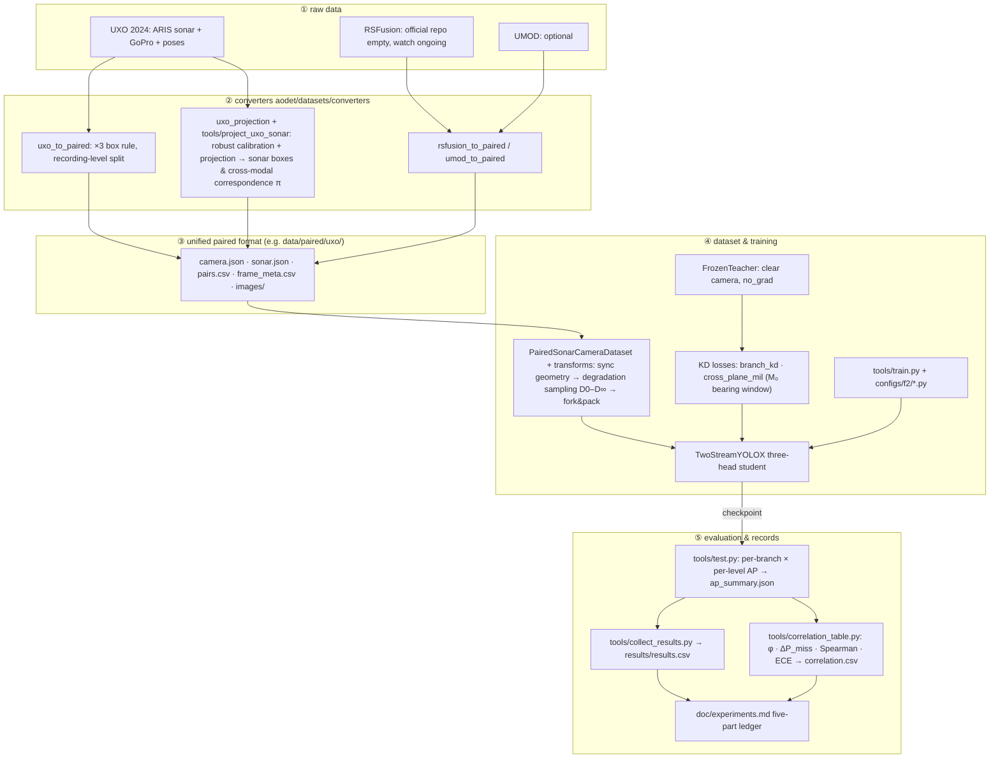

# ao-det — degradation-robust sonar–camera fusion detection (F1/F2)

English | [中文](README.zh-CN.md)

An underwater robot sails with a forward-looking sonar and a camera. The sonar is indifferent to turbidity; the camera degrades continuously with turbidity and light, from clear water (D0) through heavy degradation (D4) to effectively gone (D∞). This codebase trains and evaluates two-stream sonar–camera detectors across that whole reliability axis, asking two questions: does training-time privileged distillation (a teacher that sees the clear camera, a student that sees the degraded one) beat inference-time feature fusion at protecting the sonar branch; and what does this "mutual enhancement" cost, given that downstream consumers treat the two branches' detections as independent evidence — how much does it correlate their errors?

Full research plan: `doc/topic-f2-degradation-robust-fusion-detection-distillation-2026-10.md` · current direction and roadmap (2026-11-01 review, read first): `doc/f2-rethink-2026-11-01.md` · experiment ledger (per experiment: setup / results / interpretation / conclusion): `doc/experiments.md` · narrative build logs: `doc/logs/` (Chinese).

Base stack: MMDetection 3.3.0 (YOLOX family) + mmengine 0.10.7 + torch 2.1.2, pinned in `env/` (a torch 2.7.1+cu128 `.venv-gpu` exists for the local RTX 5090; see `env/ENVIRONMENT.md`). No third-party repo is modified: `third_party/` is cloned read-only with pinned SHAs (`tools/clone_third_party.sh`, `third_party/PINNED.md`).

## 1. The problem this code addresses

Deployment reality: an ROV/AUV has both a forward-looking sonar and a camera online, and camera reliability is a continuum, not a switch. Existing methods cover only the two ends of that spectrum: sonar-only distillation (CMOLD/CMHD; the D∞-endpoint expert, wastes the camera when it is clear) and inference-time fusion trained under nominal conditions (RSFusionDet et al.; never systematically tested under degradation). In clear water, feature fusion buys a single branch only ~1 AP; the headroom is in the degraded regime. And no acoustic–optic detection work in the literature has reported branch error correlation, yet downstream consumers (target mapping / association) use per-modality detections as conditionally independent evidence, so AP bought by mutual enhancement can turn into downstream overconfidence. Full argument: topic doc §1.

This repo runs controlled comparisons — same framework (MMDetection/YOLOX), same data, same degradation protocol:

| research question | in one line | where it lives in the code |
|---|---|---|
| RQ-0 (gate) | Does inference-time cross-attention fusion drag the sonar branch down as the camera degrades (mutual poisoning)? | per-branch D0–D∞ scan of `s0_cross_attn` vs `s0_b0` (`tools/test.py`) |
| RQ-1 | For the sonar branch, is training-time distillation or inference-time fusion more effective? | method space B1 vs B2/B3 vs M3 (§2.3) |
| RQ-2 | Of the distillation gain, how much is capacity gain (big teacher → small student) vs privileged gain (teacher sees clear, student sees degraded)? | 2×2 attribution: same/large teacher × degraded/clear teacher input |
| RQ-3 | Is cross-plane bearing-window distillation better than per-grid distillation? | `aodet/models/losses/cross_plane_mil.py` |
| RQ-4 | How much does mutual enhancement correlate the two branches' errors, and what does that cost? | `aodet/evaluation/branch_correlation.py` |

## 2. Approach

### 2.1 The student: two streams, three heads

Every method shares one student skeleton, `TwoStreamYOLOX` (YOLOX-S scale; teacher and student stay in the same family so per-prediction distillation lines up):

```
camera image ──► cam backbone ──► cam neck ──┬────────────────► camera head          (L_det^c)
                                              │                  degraded D0–D∞ at train time
sonar  image ──► son backbone ──► son neck ──┼──► fusion ──────► fused sonar head    (L_det^s)
  (never degraded)                           │
                                              └────────────────► uncoupled sonar head (L_det^s0)
                                                                 · pre-fusion sonar features only,
                                                                   never sees the camera
                                                                 · D∞ fallback + decoupled
                                                                   bookkeeping, reported separately
```

- The camera head reads camera features; the fused sonar head reads fused features (default: cross-attention, sonar queries camera); each is supervised by its own modality's GT.
- The uncoupled sonar head is the design key (topic doc, tension 1): it yields a sonar output uncontaminated by camera coupling, falls back naturally at D∞, and is accounted separately at evaluation time.
- Dropping the camera stream (`camera_backbone=None` + `NoneFusion`) yields the B0 sonar-only baseline, the strongest single-modality reference inside the same framework.

### 2.2 Privileged distillation

The teacher always sees the clear camera frames (geometric augmentation applied synchronously to teacher and student), so its outputs can be cached offline; currently it runs online under `no_grad` (`FrozenTeacher`), and the cache must pass an equivalence test first.

```
clear camera frame ──► FrozenTeacher (bigger / same-capacity two-stream YOLOX, no_grad)
        │
        ├─ head objectness + class distribution ──► branch_kd ──► student camera/sonar heads
        │                                   (objectness & class only, no box regression)
        │
        └─ camera detections ──► M₀ nominal geometry (camera angle → sonar bearing window)
                            └─► cross_plane_mil: inside the window, the student sonar
                                 head's MAX objectness along range must match the teacher
                                 · positive evidence only: camera missed ≠ nothing in the strip
                                 · windows widened by the M₀ calibration residual
```

Training distribution: each sample's camera input draws s ~ p(s) from {D0,…,D4,D∞} (`AOSampleDegLevel`). At train time D∞ is materialised as a black frame (batches stay dense, `dinf_mode="zero"`); at test time the camera is truly dropped (batch 1, `dinf_mode="drop"`). The sonar is never degraded: the sonar-configuration axis belongs to the sibling topic F1.

### 2.3 Method space and where this repo stands

| family | topic-doc id | recipe | status (2026-11-01) |
|---|---|---|---|
| sonar-only baseline | B0 | single-stream single-head YOLOX-S | `configs/f2/e09_s0_b0_jitter_yoloxs.py` (E09b); test sonar sits on the floor on the sample platform (class-aware ≤ 0.04) |
| inference-time fusion | ≈B2/B3 | two streams, three heads + cross-attention, p(s) degradation sampling in training | `configs/f2/e10_b3_degaug_yoloxs.py` (B3), `s0_b2_cross_attn_nominal_yoloxs.py` (B2); E09c/E10 sonar heads on the floor, RQ-0 not measurable |
| privileged distillation | B1, M1–M5 | frozen clear-view teacher + branch_kd + (M4) cross-plane MIL | E10 M3 (τ=2) gives only a directional camera-branch reading, verdict downgraded; cross-modal class route (teacher camera → student sonar via π) to be implemented, tested in E12 |
| late fusion reference | B5 | two single-modality detectors matched at result level | planned (structurally uncoupled; correlation reference) |

The full method space (B0–B6, M1–M5) is defined in topic doc §2.2; per-experiment progress lives in `doc/experiments.md`.

Mainline status (2026-11-01 review, see `doc/f2-rethink-2026-11-01.md`, Chinese): E01–E10 fixed a chain of foundation problems that would have distorted any fusion/distillation verdict (table below), but the sample platform cannot measure F2's core question. Each of the 5 recordings holds exactly one class and each class has a single training recording, so class and recording are fully confounded; sonar readings have stayed on the floor; seed noise (about ±0.02) is the same size as E10's decision threshold. E10's positive camera reading comes from a class-ranking shift on one recording (100927), with privilege, capacity and class prior not separated, and E10's sonar route (sonar←sonar) cannot carry privileged information when fusion barely uses the camera. Adjustment: research questions unchanged; the measurement platform moves to a class-balanced recording-level split of the full UXO dataset (E11), which first measures the ceiling, the platform band and σ; then cross-modal class distillation with a class-prior control tests H-cls (E12), with the sonar branch back as the primary endpoint.

| foundation finding | consequence for fusion/distillation if left unfixed |
|---|---|
| GT double-scale poisoning: geometric projection boxes span half the image while echoes are compact (E04) | the sonar head never learns boxes; every KD loss is computed on wrong supervision |
| evaluation aliasing bug: the two sonar heads share samples and the later fused pass overwrites the earlier uncoupled one (E07 erratum 2) | the fusion-vs-no-fusion comparison compared one output against itself; "fusion has no effect" was a measurement artifact; fixed + anti-alias regression test |
| KD loss keys without a "loss" prefix are logged but never backpropagated by mmengine (code review §1.1) | M-series distillation losses would train nothing while looking healthy; fixed, distillation starts from the new code |
| scale jitter exactly undone by the fixed-size resize (E08 erratum) | scale-augmentation robustness conclusions are guaranteed false negatives; E09b confirms the scale axis fixed with the repaired jitter |
| old training recipe: no pretrain, 8× lr, no EMA (E07 erratum 3) | B2-vs-B0 and M1-vs-B2 gains are unattributable; E09 switches to the sound recipe |
| recording-level domain collapse + class–recording confound: both modalities collapse on unseen recordings (E07); each class has one training recording in the sample (E08) | every method's sonar reading lands on the floor and effects along s are unmeasurable; remedy is a class-balanced split of the full UXO dataset (E11) |


## 3. Architecture and data flow

Every source dataset is first converted into one paired format; dataset, training and evaluation code are then shared verbatim:



Stage notes:

1. Conversion: one converter per source (UXO is converted end-to-end: 2573 pairs + projection report; the RSFusion/UMOD converters await data). Sonar boxes have no manual annotation; `uxo_projection` calibrates per recording against the official poses and projects. Training GT uses gated visible-echo boxes only (`sonar_gt_sources=("blob",)`; the E06 validity gate showed projected-source frames carry no echo by construction), while projected boxes (clamped to echo scale) serve cross-modal correspondence and the `gt=all` eval view.
2. Paired format: four JSON/CSV files + image dirs are the entire state; `frame_meta.csv` keys each sample to both COCO image ids, the split and the degradation seed.
3. Training: pipeline order is fixed (sync geometry → degradation sampling → fork & pack), no Mosaic/MixUp (teacher/student augmentation must stay synchronous); multi-seed runs via `tools/run_seeds.sh`.
4. Evaluation: `tools/test.py` overrides the dataset's `deg_level` field per level, then infers and stores per-branch predictions and AP; the correlation tool consumes only these stored files, so every method shares the same evaluation path.
5. Records: every experiment enters `doc/experiments.md` in five parts (setup / results / interpretation / conclusion); day-level debugging narratives live in `doc/logs/`.

## 4. Layout

| path | contents |
|---|---|
| `aodet/datasets/` | paired-format I/O (`paired_format.py`), `PairedSonarCameraDataset`, converters (`uxo_to_paired`, `uxo_projection`, `rsfusion_to_paired`, `umod_to_paired`), transforms (paired geometry, camera degradation D0–D∞, fork & pack) |
| `aodet/models/` | `TwoStreamYOLOX` (three heads, `detectors/`), fusion modules (`fusion/`: cross-attn / concat / none), KD losses (`losses/`: `branch_kd`, `cross_plane_mil`), frozen teacher (`teachers/`), `PairedDataPreprocessor` |
| `aodet/evaluation/` | per-branch COCO AP (`per_branch_metric.py`), branch error correlation (`branch_correlation.py`: φ, ΔP_miss, Spearman, naive-Bayes fusion, ECE) |
| `aodet/geometry/` | M₀ camera→bearing mapping + flip mirroring (`m0.py`), ARIS beam table |
| `configs/` | `_base_` (model/dataset/schedule/runtime) + `f2/` S0-lite configs (B0, cross-attn) |
| `tools/` | `train.py`, `test.py` (per-branch D0–D∞ scan), `project_uxo_sonar.py` (calibration + projection), `check_gt_validity.py`, `make_degraded_testsets.py`, `run_seeds.sh`, `collect_results.py`, `correlation_table.py`, third-party pinning, RSFusionDet watch |
| `tests/` | 161 tests (collected 2026-11-01): degradation physics, format round-trip, geometry, metrics, model, UXO converter & projection, end-to-end pipeline & tools |
| `env/` | install scripts + `ENVIRONMENT.md` version record |
| `doc/` | topic plans, experiment ledger `experiments.md`, narrative logs `doc/logs/`, evidence archive `doc/evidence/` |
| `data/paired/` | converted paired data (UXO: 2573 pairs + projection report & contact sheet) |

## 5. Quick start

```bash
source .venv/bin/activate
python -m pytest tests/ -q          # 161 tests collected (2026-11-01)

# S0-lite (UXO sample already converted to data/paired/uxo/)
python tools/train.py configs/f2/s0_b0_sonar_only_yoloxs.py --seed 0
# mmengine writes epoch_N.pth + last_checkpoint (no latest.pth symlink)
ckpt=$(cat work_dirs/s0_b0_sonar_only_yoloxs_seed0/last_checkpoint)
python tools/test.py  configs/f2/s0_b0_sonar_only_yoloxs.py "$ckpt" \
    --out-dir work_dirs/s0_b0_sonar_only_yoloxs_seed0
python tools/collect_results.py work_dirs --out results/results.csv
```

Per-experiment setup, result tables, interpretation and conclusions are kept in `doc/experiments.md` (Chinese); narrative build logs live in `doc/logs/`.

## 6. Paired format (one layout for every source dataset)

```
<root>/camera.json  sonar.json  pairs.csv  frame_meta.csv
<root>/images/camera/...  images/sonar/...
```

`frame_meta.csv` keys each `sample_id` to both COCO image ids, the split and the degradation seed; `read_paired` normalises CSV types. Sync flips are only legal while the sonar bearing axis is 0°-centred (`sonar_zero_centred=True`).

## 7. Degradation protocol

`aodet/datasets/transforms/camera_degradation.py`: physically ordered operator (attenuation → wavelength absorption → scattering veil → blur) with levels D0–D4, D∞ (black / sensor-absent), deterministic per (sample_id, level, seed). Training draws levels from p(s) (F2 §5.2) with D∞ materialised as a black frame (`dinf_mode="zero"`, dense batches); test-time D∞ drops the camera (`dinf_mode="drop"`, batch 1). Offline pinned test sets: `tools/make_degraded_testsets.py` (sha256 manifest per level).

## 8. Evaluation

Per-branch AP by degradation level from saved prediction files (`tools/test.py` → `pred.<branch>.<level>.json` + `ap_summary.json`). Sonar branches are reported against both the full GT and the blob-only subset (`gt=all` / `gt=blob`): projected boxes carry the calibration's range-axis error, so the blob subset is the clean reference. Branch error correlation (φ, conditional miss lift ΔP_miss with bootstrap CI, Spearman confidence correlation, naive-Bayes fused existence ECE) in `aodet/evaluation/branch_correlation.py`, run over a work dir via `tools/correlation_table.py` → `correlation.csv`.

## 9. Status (2026-11-01)

- Environment and pipeline: COCO YOLOX-S reproduction gate passed (AP 40.30 vs official 40.5); the local RTX 5090 runs `.venv-gpu` (torch 2.7.1+cu128, see `env/ENVIRONMENT.md`).
- Data: the UXO sample is converted to `data/paired/uxo/` (2573 pairs; recalibrated after the mirror-basin fix to blob 1319 / projected 1254). Training GT is blob-only; projected boxes serve only π and the `gt=all` view.
- Experiments: E01–E10 in `doc/experiments.md`. E10 is downgraded to a directional reading after the review; the τ ∈ {1, 4} arms are recorded but not interpreted.
- Next: E11 (full-UXO class-balanced split + B0/B2/B3 × 3 seeds) is preregistered and waits on the full download and code prerequisites (fingerprinted calibration cache, three-way split, recording inventory, per-split evaluation with known-answer tests).
- Open decisions: whether to download full UXO and fund E11; how the paper is positioned if E11 lands in the ceiling or floor band (review §3.5, §7).
- RSFusionDet repo still empty (checked biweekly, `doc/logs/rsfusiondet-watch.log`).
