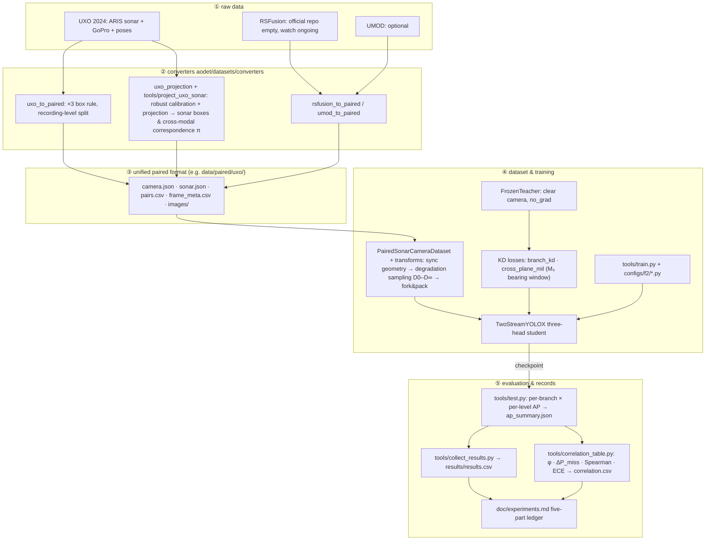

# ao-det — degradation-robust sonar–camera fusion detection (F1/F2)

English | [中文](README.zh-CN.md)

An underwater robot sails with a forward-looking sonar and a camera. The sonar is indifferent to turbidity; the camera degrades continuously with turbidity and light, from clear water (D0) through heavy degradation (D4) to effectively gone (D∞). This codebase trains and evaluates two-stream sonar–camera detectors across that whole reliability axis, asking two questions: does training-time privileged distillation (a teacher that sees the clear camera, a student that sees the degraded one) beat inference-time feature fusion at protecting the sonar branch; and what does this "mutual enhancement" cost, given that downstream consumers treat the two branches' detections as independent evidence — how much does it correlate their errors?

Full research plan: `doc/topic-f2-degradation-robust-fusion-detection-distillation-2026-10.md` · experiment ledger (per experiment: setup / results / interpretation / conclusion): `doc/experiments.md` · narrative build logs: `doc/logs/` (Chinese).

Base stack: MMDetection 3.3.0 (YOLOX family) + mmengine 0.10.7 + torch 2.1.2, pinned in `env/` (a torch 2.7.1+cu128 `.venv-gpu` exists for the local RTX 5090; see `env/ENVIRONMENT.md`). No third-party repo is modified: `third_party/` is cloned read-only with pinned SHAs (`tools/clone_third_party.sh`, `third_party/PINNED.md`).

## 1. The problem this code addresses

Deployment reality: an ROV/AUV has both a forward-looking sonar and a camera online, and camera reliability is a continuum, not a switch. Existing methods cover only the two ends of that spectrum: sonar-only distillation (CMOLD/CMHD; the D∞-endpoint expert, wastes the camera when it is clear) and inference-time fusion trained under nominal conditions (RSFusionDet et al.; never systematically tested under degradation). In clear water, feature fusion buys a single branch only ~1 AP; the headroom is in the degraded regime. And no acoustic–optic detection work in the literature has reported branch error correlation, yet downstream consumers (target mapping / association) use per-modality detections as conditionally independent evidence, so AP bought by mutual enhancement can turn into downstream overconfidence. Full argument: topic doc §1.

This repo runs controlled comparisons — same framework (MMDetection/YOLOX), same data, same degradation protocol:

| research question | in one line | where it lives in the code |
|---|---|---|
| RQ-0 (gate) | Does inference-time cross-attention fusion drag the sonar branch down as the camera degrades (mutual poisoning)? | per-branch D0–D∞ scan of `s0_cross_attn` vs `s0_b0` (`tools/test.py`) |
| RQ-1 | For the sonar branch, is training-time distillation or inference-time fusion more effective? | method space B1 vs B2/B3 vs M3 (§2.3) |
| RQ-2 | Of the distillation gain, how much is capacity gain (big teacher → small student) vs privileged gain (teacher sees clear, student sees degraded)? | 2×2 attribution: same/large teacher × degraded/clear teacher input |
| RQ-3 | Is cross-plane bearing-window distillation better than per-grid distillation? | `aodet/models/losses/cross_plane_mil.py` |
| RQ-4 | How much does mutual enhancement correlate the two branches' errors, and what does that cost? | `aodet/evaluation/branch_correlation.py` |

## 2. Approach

### 2.1 The student: two streams, three heads

Every method shares one student skeleton, `TwoStreamYOLOX` (YOLOX-S scale; teacher and student stay in the same family so per-prediction distillation lines up):

```
camera image ──► cam backbone ──► cam neck ──┬────────────────► camera head          (L_det^c)
                                              │                  degraded D0–D∞ at train time
sonar  image ──► son backbone ──► son neck ──┼──► fusion ──────► fused sonar head    (L_det^s)
  (never degraded)                           │
                                              └────────────────► uncoupled sonar head (L_det^s0)
                                                                 · pre-fusion sonar features only,
                                                                   never sees the camera
                                                                 · D∞ fallback + decoupled
                                                                   bookkeeping, reported separately
```

- The camera head reads camera features; the fused sonar head reads fused features (default: cross-attention, sonar queries camera); each is supervised by its own modality's GT.
- The uncoupled sonar head is the design key (topic doc, tension 1): it yields a sonar output uncontaminated by camera coupling, falls back naturally at D∞, and is accounted separately at evaluation time.
- Dropping the camera stream (`camera_backbone=None` + `NoneFusion`) yields the B0 sonar-only baseline, the strongest single-modality reference inside the same framework.

### 2.2 Privileged distillation

The teacher always sees the clear camera frames (geometric augmentation applied synchronously to teacher and student), so its outputs can be cached offline; currently it runs online under `no_grad` (`FrozenTeacher`), and the cache must pass an equivalence test first.

```
clear camera frame ──► FrozenTeacher (bigger / same-capacity two-stream YOLOX, no_grad)
        │
        ├─ head objectness + class distribution ──► branch_kd ──► student camera/sonar heads
        │                                   (objectness & class only, no box regression)
        │
        └─ camera detections ──► M₀ nominal geometry (camera angle → sonar bearing window)
                            └─► cross_plane_mil: inside the window, the student sonar
                                 head's MAX objectness along range must match the teacher
                                 · positive evidence only: camera missed ≠ nothing in the strip
                                 · windows widened by the M₀ calibration residual
```

Training distribution: each sample's camera input draws s ~ p(s) from {D0,…,D4,D∞} (`AOSampleDegLevel`). At train time D∞ is materialised as a black frame (batches stay dense, `dinf_mode="zero"`); at test time the camera is truly dropped (batch 1, `dinf_mode="drop"`). The sonar is never degraded: the sonar-configuration axis belongs to the sibling topic F1.

### 2.3 Method space and where this repo stands

| family | topic-doc id | recipe | status (2026-11-01) |
|---|---|---|---|
| sonar-only baseline | B0 | single-stream single-head YOLOX-S | config `configs/f2/s0_b0_sonar_only_yoloxs.py`; post-review rerun adjudicated (E09a/b, 2026-11-01) |
| inference-time fusion | ≈B2/B3 | two streams, three heads + cross-attention, p(s) degradation sampling in training | config `configs/f2/s0_cross_attn_yoloxs.py`; reported (E09c, 2026-11-01): fused ≈ uncoupled heads, D∞ fallback correct |
| privileged distillation | B1, M1–M5 | frozen clear-view teacher + branch_kd + (M4) cross-plane MIL | modules + tests ready (`teachers/`, `losses/`); training configs gated on S0 |
| late fusion reference | B5 | two single-modality detectors matched at result level | planned (structurally uncoupled; correlation reference) |

The full method space (B0–B6, M1–M5) is defined in topic doc §2.2; per-experiment progress lives in `doc/experiments.md`.

The current phase (since 2026-10-30) has not started M-series training; all work has gone into repairing the B0 baseline and the evaluation pipeline. The reason: the fusion/distillation claim (camera-privileged information keeps the sonar branch strong when the camera is unavailable) is only measurable if the single-stream baseline and the measuring instrument are trustworthy. How this foundation work maps onto the mainline:

| foundation finding | consequence for fusion/distillation if left unfixed |
|---|---|
| GT double-scale poisoning: geometric projection boxes span half the image while echoes are compact (E04) | the sonar head never learns boxes; every KD loss is computed on wrong supervision |
| evaluation aliasing bug: the two sonar heads share samples and the later fused pass overwrites the earlier uncoupled one (E07 erratum 2) | the fusion-vs-no-fusion comparison compared one output against itself; "fusion has no effect" was a measurement artifact; fixed + anti-alias regression test |
| KD loss keys without a "loss" prefix are logged but never backpropagated by mmengine (code review §1.1) | M-series distillation losses would train nothing while looking healthy; fixed, distillation starts from the new code |
| scale jitter exactly undone by the fixed-size resize (E08 erratum) | scale-augmentation robustness conclusions are guaranteed false negatives; E09b confirms the scale axis fixed with the repaired jitter |
| old training recipe: no pretrain, 8× lr, no EMA (E07 erratum 3) | B2-vs-B0 and M1-vs-B2 gains are unattributable; E09 switches to the sound recipe |
| recording-level domain collapse: both modalities collapse together on unseen recordings (E07 verdict; camera branch also train 1.000 / test 0.15–0.19; upheld by E09a) | M-series claims would be drowned by the floor effect on a 5-recording split; the route decision (LOO-CV / full UXO / caliber re-definition) is in substance "under which evaluation design the fusion and distillation claims are measurable at all" |

One reading points straight at the mainline: localisation already transfers (E09b class-agnostic AP50 0.087 on 100927) while the class head collapses (class-aware 0.000–0.013 across arms; cross-recording predictions slide almost entirely to cat1). Class is exactly the dimension where optics is the most plausible source of privileged information (optical appearance is far more separable than sonar echo blobs), so "distillation that specifically shores up the sonar class head" becomes an M-series design hypothesis with a direct evidence handle. E09c (the cross-attn sound-recipe arm) has reported: the fused and uncoupled heads read nearly identical (100927 d0 class-agnostic 0.072 vs 0.077) and are level-by-level insensitive to camera degradation — the RQ-0 mutual-poisoning branch did not fire, and neither did mutual gain. At this scale inference-time fusion is not a source of sonar-side gain; the channel for privileged information into the sonar head converges on training-time distillation (E10 judged 2026-11-01: camera branch positive, sonar unchanged).

## 3. Architecture and data flow

Every source dataset is first converted into one paired format; dataset, training and evaluation code are then shared verbatim:



Stage notes:

1. Conversion: one converter per source (UXO is converted end-to-end: 2573 pairs + projection report; the RSFusion/UMOD converters await data). Sonar boxes have no manual annotation; `uxo_projection` calibrates per recording against the official poses and projects. Training GT uses gated visible-echo boxes only (`sonar_gt_sources=("blob",)`; the E06 validity gate showed projected-source frames carry no echo by construction), while projected boxes (clamped to echo scale) serve cross-modal correspondence and the `gt=all` eval view.
2. Paired format: four JSON/CSV files + image dirs are the entire state; `frame_meta.csv` keys each sample to both COCO image ids, the split and the degradation seed.
3. Training: pipeline order is fixed (sync geometry → degradation sampling → fork & pack), no Mosaic/MixUp (teacher/student augmentation must stay synchronous); multi-seed runs via `tools/run_seeds.sh`.
4. Evaluation: `tools/test.py` overrides the dataset's `deg_level` field per level, then infers and stores per-branch predictions and AP; the correlation tool consumes only these stored files, so every method shares the same evaluation path.
5. Records: every experiment enters `doc/experiments.md` in five parts (setup / results / interpretation / conclusion); day-level debugging narratives live in `doc/logs/`.

## 4. Layout

| path | contents |
|---|---|
| `aodet/datasets/` | paired-format I/O (`paired_format.py`), `PairedSonarCameraDataset`, converters (`uxo_to_paired`, `uxo_projection`, `rsfusion_to_paired`, `umod_to_paired`), transforms (paired geometry, camera degradation D0–D∞, fork & pack) |
| `aodet/models/` | `TwoStreamYOLOX` (three heads, `detectors/`), fusion modules (`fusion/`: cross-attn / concat / none), KD losses (`losses/`: `branch_kd`, `cross_plane_mil`), frozen teacher (`teachers/`), `PairedDataPreprocessor` |
| `aodet/evaluation/` | per-branch COCO AP (`per_branch_metric.py`), branch error correlation (`branch_correlation.py`: φ, ΔP_miss, Spearman, naive-Bayes fusion, ECE) |
| `aodet/geometry/` | M₀ camera→bearing mapping + flip mirroring (`m0.py`), ARIS beam table |
| `configs/` | `_base_` (model/dataset/schedule/runtime) + `f2/` S0-lite configs (B0, cross-attn) |
| `tools/` | `train.py`, `test.py` (per-branch D0–D∞ scan), `project_uxo_sonar.py` (calibration + projection), `check_gt_validity.py`, `make_degraded_testsets.py`, `run_seeds.sh`, `collect_results.py`, `correlation_table.py`, third-party pinning, RSFusionDet watch |
| `tests/` | 87 tests: degradation physics, format round-trip, geometry, metrics, model, UXO converter & projection, end-to-end pipeline & tools |
| `env/` | install scripts + `ENVIRONMENT.md` version record |
| `doc/` | topic plans, experiment ledger `experiments.md`, narrative logs `doc/logs/`, evidence archive `doc/evidence/` |
| `data/paired/` | converted paired data (UXO: 2573 pairs + projection report & contact sheet) |

## 5. Quick start

```bash
source .venv/bin/activate
python -m pytest tests/ -q          # 87 passed

# S0-lite (UXO sample already converted to data/paired/uxo/)
python tools/train.py configs/f2/s0_b0_sonar_only_yoloxs.py --seed 0
# mmengine writes epoch_N.pth + last_checkpoint (no latest.pth symlink)
ckpt=$(cat work_dirs/s0_b0_sonar_only_yoloxs_seed0/last_checkpoint)
python tools/test.py  configs/f2/s0_b0_sonar_only_yoloxs.py "$ckpt" \
    --out-dir work_dirs/s0_b0_sonar_only_yoloxs_seed0
python tools/collect_results.py work_dirs --out results/results.csv
```

Per-experiment setup, result tables, interpretation and conclusions are kept in `doc/experiments.md` (Chinese); narrative build logs live in `doc/logs/`.

## 6. Paired format (one layout for every source dataset)

```
<root>/camera.json  sonar.json  pairs.csv  frame_meta.csv
<root>/images/camera/...  images/sonar/...
```

`frame_meta.csv` keys each `sample_id` to both COCO image ids, the split and the degradation seed; `read_paired` normalises CSV types. Sync flips are only legal while the sonar bearing axis is 0°-centred (`sonar_zero_centred=True`).

## 7. Degradation protocol

`aodet/datasets/transforms/camera_degradation.py`: physically ordered operator (attenuation → wavelength absorption → scattering veil → blur) with levels D0–D4, D∞ (black / sensor-absent), deterministic per (sample_id, level, seed). Training draws levels from p(s) (F2 §5.2) with D∞ materialised as a black frame (`dinf_mode="zero"`, dense batches); test-time D∞ drops the camera (`dinf_mode="drop"`, batch 1). Offline pinned test sets: `tools/make_degraded_testsets.py` (sha256 manifest per level).

## 8. Evaluation

Per-branch AP by degradation level from saved prediction files (`tools/test.py` → `pred.<branch>.<level>.json` + `ap_summary.json`). Sonar branches are reported against both the full GT and the blob-only subset (`gt=all` / `gt=blob`): projected boxes carry the calibration's range-axis error, so the blob subset is the clean reference. Branch error correlation (φ, conditional miss lift ΔP_miss with bootstrap CI, Spearman confidence correlation, naive-Bayes fused existence ECE) in `aodet/evaluation/branch_correlation.py`, run over a work dir via `tools/correlation_table.py` → `correlation.csv`.

## 9. Status (2026-11-01)

- W1 environment installed + verified; COCO YOLOX-S reproduction gate passed on the full val2017 (5000 images, AP 40.30 vs official 40.5). W2 paired format / degradation / transforms / metrics done and tested; W3 model + configs + tools done, S0-lite smoke passes end-to-end on synthetic data.
- UXO sample verified (×3 label rule, GoPro alignment, extrinsics) and converted: 2573 pairs under `data/paired/uxo/` (E07 split: test = 100927 arc + 124735 line, train 1680 / test 893 frames; each test recording novel in exactly one dimension). Sonar-side boxes + cross-modal correspondence π done (TODO 14.2 item 4): per-recording robust calibration + `b_rng` anchoring + projection, `sonar.json` annotated (blob 1195 / projected 1378; after the 2026-11-01 post-mirror-fix recalibration blob 1319 / projected 1254, test box set unchanged), `pairs.csv` written; error stats + contact sheet in `data/paired/uxo/projection_report.json` / `projection_check.jpg` and the W1–W3 log.
- GPU env ready for S0-lite on this box (RTX 5090 D v2 24 GB): `.venv-gpu` with torch 2.7.1+cu128 + source-built CPU-ops mmcv 2.1.0 and an NMS CPU fallback (`aodet/cuda_compat.py`); see `env/ENVIRONMENT.md`. Pinned cu121 stack cannot run on Blackwell; the CPU/debug `.venv` is untouched.
- S0-lite first run exposed a GT-semantics flaw: geometric projection boxes span half the image at tank ranges while real echoes are compact, so AP stayed ~0 despite converged training (E04); projected boxes are now clamped to echo scale. The clamped retrain (E05) still scored test AP ≈ 0 with train AP50 = 0.80; root cause: the E02 recording-level split confounded geometry (3 arcs in train / 2 lines in test) and projected boxes mark no-echo frames (E06 validity gate). E06 anchored the calibration (blob-frame dy p50 1.5–6 px) and moved training GT to blob-only; E07 retrains B0 + cross-attn on the single-novelty split.
- After a colleague's code review (merged 2026-10-31, `doc/reviews/2026-10-31-f2-code-review.md`) the repo entered a post-review rerun phase: E08 voided on both arms (the scale jitter was a no-op + old-recipe confound, erratum recorded), every registered conclusion re-audited (`doc/experiments.md` 3.x.1), and all five recordings recalibrated after the mirror-basin fix into a new GT baseline (blob 1319 / projected 1254, test references unchanged). E09 reruns three arms in parallel (recipe control / true jitter / new-arch cross-attn): a/b adjudicated — domain collapse upheld (main criterion in the partial band, 0.013), scale axis fixed (class-agnostic +0.061), class axis promoted to the primary bottleneck (cat3 sensitive to both recipe and augmentation), 124735 regression tripping the no-harm criterion; arm c: fused and uncoupled heads read the same (100927 d0 class-agnostic 0.072 vs 0.077), level-by-level insensitive to camera degradation, D∞ camera zero-prediction fallback correct — inference-time fusion neither poisons nor helps. The mapping from foundation work to the fusion/distillation mainline is tabulated in §2.3.
- E10 (2026-11-01) is the first method-layer experiment: privileged distillation M3 vs strong baseline B3 with a YOLOX-L dual-stream teacher T-L. Gate 0 failed on the absolute margin (T-L camera 0.1270 < 0.1500) and was re-ruled by the user as a documented deviation (T-L ≥ 2×B3 relative margin, train self-eval 1.000 — both met); B3 camera d0 0.0500 was audited per recording before judging: 100927 localisation is solved (class-agnostic 0.9247) and the loss is pure class confusion (cat2 1347 vs cat3 145 predictions on an all-cat3 recording), while 124735 is a structural zero — the only moving-target recording (camera GT centre descends 576→976, sonar GT range axis 152→314; 165/168 tall boxes, 93/168 bottom-clipped) whose annotation style every model misses at IoU ≤ 0.28 while tracking the object with correct class at 0.9+ confidence in 168/168 frames. M3 (τ=2, first temperature implementation) judged the same night (20:36): criterion 1 holds — camera AP50 beats B3 at every level d0–d4, mean Δ(d2:d4) = +0.0434 ≥ +0.02 with the gap widening under degradation (d4 +0.0539); criterion 2 holds (mean retention d1:d4 1.123 vs 0.727); criteria 3/4 no-harm pass (sonar heads flat at ≈0.0098/0.0093 blob AP50 across levels, D∞ camera silent). The anatomy decomposition attributes the entire pooled gain to the 100927 class axis (cat3-aware 0.1004 → 0.1355, cat3 predictions +55%; class-agnostic flat ≈0.92, top-1 IoU identical at 0.62): distillation currently improves detection by nudging class confusion, not by fixing localisation — pooled and decomposed numbers must be reported side by side. A same-day literature check (`doc/logs/2026-11-01-e10-literature-check.md`) found no published cross-recording protocol on this dataset (CMOLD: same-distribution split, self-made sonar labels, sonar-only baseline AP50 0.943; CMHD: class-balanced trajectory-level split, 0.66–0.80 mAP@[.50:.95]; no camera-branch test numbers anywhere), so absolute levels stay capped by the two dataset-domain issues and are not comparable to published figures. Criterion 6 (τ ∈ {1,4}) auto-triggered and runs overnight. Preregistered criteria 1–6 in `doc/experiments.md` E10, audit trail in `doc/logs/2026-11-01-e10-camera-audit.md`.
- RSFusionDet repo still empty (route a watch ongoing).
